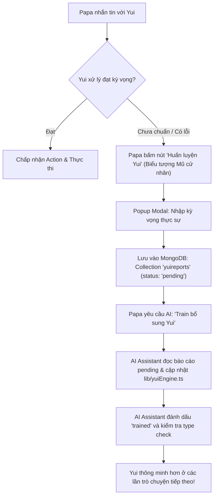

# [ PROTOCOL // MHCP-001 ] HƯỚNG DẪN HUẤN LUYỆN & HỌC LIÊN TỤC CHO YUI (CONTINUOUS LEARNING GUIDE)

> **Mục đích tài liệu:** Lưu trữ quy trình, cấu trúc dữ liệu và hướng dẫn vận hành cơ chế **"Huấn luyện Yui" (Continuous Learning Loop)**. Khi Papa (User) yêu cầu:  
> *"Train Yui"*, *"Train bổ sung Yui"*, *"Đọc báo cáo và huấn luyện Yui"* hoặc dẫn link tài liệu này, **AI Assistant (Antigravity)** sẽ tự động thực hiện toàn bộ quy trình mà Papa không cần gõ lệnh thủ công nào.

---

## 1. KIẾN TRÚC & LUỒNG HOẠT ĐỘNG (ARCHITECTURE OVERVIEW)



---

## 2. QUY TRÌNH DÀNH CHO AI ASSISTANT (ANTIGRAVITY PLAYBOOK)

Khi Papa gửi yêu cầu huấn luyện Yui, Antigravity **TỰ ĐỘNG** thực hiện 5 bước sau theo thứ tự:

### BƯỚC 1: Đọc tất cả báo cáo đang chờ (`status: "pending"`)
Chạy lệnh kiểm tra báo cáo:
```bash
node scripts/train_yui_from_reports.mjs
```
*Script sẽ in ra danh sách các case gồm:*
- `user_message`: Câu nói thực tế của Papa.
- `yui_reply`: Lời Yui trả lời tại thời điểm đó.
- `suggested_actions`: Các actions Yui từng sinh ra.
- `expected_behavior`: Mô tả mong muốn thực sự của Papa.
- `context_snapshot`: Ngữ cảnh ví, kho đồ, danh mục tại lúc xảy ra.

### BƯỚC 2: Phân tích & Cập nhật Engine ([lib/yuiEngine.ts](file:///d:/myproject/mybag/lib/yuiEngine.ts))
Dựa vào `expected_behavior`, xác định phương án xử lý:
1. **Bổ sung / Tinh chỉnh Grounding Rules** trong `SYSTEM_PROMPT` của Yui:
   - Quy tắc xử lý từ ngữ (ví dụ: "trả hộ", "hết gia vị", "nấu ăn",...).
   - Quy tắc sinh schema Actions (`actionType`, `meal`, `update_inventory`, `transfer`, `create_shopping_item`,...).
2. **Cập nhật Logic Sanitizer (`sanitizeActions`)**:
   - Tự động chuẩn hóa dữ liệu đầu ra từ LLM trước khi gửi về client (ví dụ: gộp cặp Chi trả hộ + Thu hồi lại thành 1 action `transfer`).
3. **Thêm Few-Shot Examples**:
   - Nếu là ca hội thoại phức tạp hoặc dễ nhầm lẫn, bổ sung mẫu hỏi-đáp vào phần Few-Shot trong prompt.

### BƯỚC 3: Kiểm tra tính toàn vẹn (Type Check & Test)
Kiểm tra TypeScript để đảm bảo không gãy build:
```bash
npx tsc --noEmit
```

### BƯỚC 4: Đánh dấu các báo cáo đã được học (`status: "trained"`)
Chạy script với cờ `--mark-trained`:
```bash
node scripts/train_yui_from_reports.mjs --mark-trained
```
Tất cả các bản ghi pending vừa xử lý sẽ được cập nhật sang `status: "trained"`, kèm thời gian cập nhật.

### BƯỚC 5: Báo cáo kết quả cho Papa
- Tóm tắt ngắn gọn các case vừa học được.
- Giải thích các logic / quy tắc mới đã được nạp vào não bộ Yui.
- Tạo liên kết `file://` tới các file đã cập nhật (VD: [lib/yuiEngine.ts](file:///d:/myproject/mybag/lib/yuiEngine.ts)).

---

## 3. CẤU TRÚC DỮ LIỆU BÁO CÁO (SCHEMA REFERENCE)

Model: [models/YuiReport.ts](file:///d:/myproject/mybag/models/YuiReport.ts)  
Collection: `yuireports`

```typescript
export interface IYuiReport {
  user_id: string;              // ID người dùng (hoặc 'default_user')
  user_message: string;         // Câu nói của Papa
  yui_reply?: string;           // Lời đáp Yui đưa ra
  suggested_actions?: any[];    // Actions Yui đề xuất bị sai/thiếu
  expected_behavior: string;    // Mong muốn thực sự của Papa
  context_snapshot?: {          // Snapshot trạng thái kho đồ, ví, v.v.
    wallets?: any[];
    inventory_items?: any[];
  };
  status: 'pending' | 'reviewed' | 'trained' | 'dismissed';
  notes?: string;               // Ghi chú của AI khi cập nhật
  createdAt: Date;
  updatedAt: Date;
}
```

---

## 4. CÁC ĐIỂM MỞ RỘNG TRONG CODEBASE (KEY EXTENSION POINTS)

1. **Prompt & Quy tắc nền tảng:**
   - [lib/yuiEngine.ts](file:///d:/myproject/mybag/lib/yuiEngine.ts): `YUI_SYSTEM_INSTRUCTION`, `GROUNDING_RULES`, `sanitizeActions`.
2. **API Tiếp nhận Feedback:**
   - [app/api/ai/yui/report/route.ts](file:///d:/myproject/mybag/app/api/ai/yui/report/route.ts): Nhận POST từ giao diện người dùng.
3. **Giao diện Báo cáo:**
   - [app/components/yui/YuiAssistant.tsx](file:///d:/myproject/mybag/app/components/yui/YuiAssistant.tsx): Nút `GraduationCap` và Modal Góp ý.
   - [app/components/yui/YuiAssistant.module.css](file:///d:/myproject/mybag/app/components/yui/YuiAssistant.module.css): Styling SAO Cyberpunk HUD.
4. **Script Huấn Luyện Tự Động:**
   - [scripts/train_yui_from_reports.mjs](file:///d:/myproject/mybag/scripts/train_yui_from_reports.mjs): Truy xuất DB, hiển thị case và cập nhật trạng thái `trained`.

---

## 5. NHẬT KÝ BÀI HỌC ĐÃ TÍCH HỢP (KNOWLEDGE BASE HISTORY)

| Mã Case | Ngày | Ngữ cảnh thực tế | Cách Yui xử lý chuẩn |
|---|---|---|---|
| **KB-001** | 26/11/2026 | "hết cả dầu ăn" khi xào thịt bò | Dầu ăn (Gia vị / `spices`) cập nhật `stock_status: 'out'` và gợi ý mua sắm (`create_shopping_item`), KHÔNG nhét số lượng lớn vào `ingredients_used` của bữa ăn. |
| **KB-002** | 26/11/2026 | "trả hộ anh A 40k ví X, anh A trả lại 40k ví Y" | Đây là luân chuyển dòng tiền qua 2 ví, Yui tự động gộp thành 1 action `transfer` (Ví X -> Ví Y) thay vì tách thành Chi tiêu + Thu nhập làm sai lệch báo cáo tài chính. |
| **KB-003** | 26/11/2026 | "Chuyển 200k từ MB sang tiền mặt do em Tú muốn đổi" | Mô tả hành động/giao dịch viết súc tích, trực diện (2-5 từ) như sổ tay cá nhân: "Em Tú đổi tiền", loại bỏ câu chữ rườm rà robot "Đổi tiền mặt theo yêu cầu của...". |
